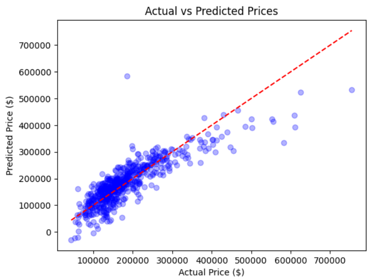

# 🏡 Ames Housing Price Prediction: End-to-End ML Pipeline & Custom Gradient Descent from Scratch

[](https://github.com/no984/ames-housing)
[](https://www.python.org/)
[](https://scikit-learn.org/)
[](https://numpy.org/)
[](https://xgboost.readthedocs.io/)
[](https://opensource.org/licenses/MIT)

---

## 📌 Executive Summary & Philosophy

This project bridges **first-principles mathematical optimization** with **production-grade Machine Learning pipeline design** using the real-world **Ames Housing Dataset** (2,930 properties across 82 raw attributes).

> ⚠️ **Core Philosophy Note:**  
> The **Custom Vectorized Gradient Descent** algorithm in this repository was deliberately developed **from scratch purely as a practical and academic deep dive**. The goal was to open the "black box" of optimization, master matrix derivations ($X^T X$, vectorized derivatives, and norm-based convergence), and integrate custom NumPy algorithms into modern `scikit-learn` Pipelines. For production benchmarks, we compare it against the analytical closed-form solution (Normal Equations) and state-of-the-art non-linear gradient-boosted trees (**XGBoost**).

---

## 🏗️ Architecture & End-to-End Workflow

```
Raw Ames Housing Data (82 features)
          │
          ▼
┌────────────────────────────────────────────────────────┐
│ 1. Data Cleaning & Semantic Missingness (MCAR/MNAR)    │
│    • Structural Absence ('None') vs Random Loss        │
│    • Elimination of Sparse / High-Noise Columns        │
└──────────────────────────┬─────────────────────────────┘
                           │
                           ▼
┌────────────────────────────────────────────────────────┐
│ 2. Multicollinearity & Rank Deficiency Prevention      │
│    • Sub-basement Sum Constraint Resolution            │
│    • Pairwise High Correlation Filtering (|r| > 0.80)  │
└──────────────────────────┬─────────────────────────────┘
                           │
                           ▼
┌────────────────────────────────────────────────────────┐
│ 3. Unified ColumnTransformer Pipeline (Leak-Free)     │
│    • StandardScaler (Numeric)                          │
│    • OrdinalEncoder (Quality Scales)                   │
│    • OneHotEncoder(drop='first') (Nominal Categories)  │
└──────────────────────────┬─────────────────────────────┘
                           │
          ┌────────────────┴────────────────┬────────────────┐
          ▼                                 ▼                ▼
┌─────────────────────┐          ┌────────────────────┐   ┌────────────────┐
│ Custom GD Estimator │          │  Normal Equations  │   │    XGBoost     │
│ (NumPy From Scratch)│          │ (Closed-Form OLS)  │   │ (Tree Ensemble)│
│   R² ≈ 72.4%        │          │    R² ≈ 86.2%      │   │   R² ≈ 95.0%   │
└─────────────────────┘          └────────────────────┘   └────────────────┘
```

---

## 🧗 Challenges Encountered & Engineering Solutions

Building an authentic machine learning system from messy tabular data exposed several mathematical, statistical, and software engineering challenges:

### 1. The Missingness Trap (MCAR vs. MNAR)
- **The Issue:** Over 80% of properties had missing values in `PoolQC`, `MiscFeature`, `Alley`, and `Fence`. Standard mean/mode imputation would inject massive artificial noise.
- **The Resolution:** Conducted domain missingness analysis. These values were **Missing Not at Random (MNAR)**—an absence of a value simply meant the home lacked a swimming pool or alley. We mapped missing structural amenities to `'None'` and dropped near-zero variance features that introduced noise rather than predictive signal.


### 2. Matrix Singularity & Multicollinearity ($\det(X^T X) = 0$)
- **The Issue:** In linear models and Normal Equations, exact linear combinations cause non-invertible singular matrices. In the Ames dataset:
  $$\text{BsmtFinSF1} + \text{BsmtFinSF2} + \text{BsmtUnfSF} = \text{TotalBsmtSF}$$
  Furthermore, pairwise correlations between `1stFlrSF` and `TotalBsmtSF` ($r = 0.80$), as well as `TotRmsAbvGrd` and `GrLivArea` ($r = 0.81$), inflated weight variances.
- **The Resolution:** Dropped redundant sub-components in favor of holistic measures (`TotalBsmtSF` and `GrLivArea`), preserving full rank for $X$.

### 3. The Dummy Variable Trap in Categorical Encoding
- **The Issue:** One-hot encoding $K$ categories without dropping the reference level creates perfect multicollinearity with the intercept (bias) column:
  $$\sum_{j=1}^K D_j = \mathbf{1}$$
- **The Resolution:** Enforced `OneHotEncoder(drop='first', sparse_output=False)` to maintain linear independence.

### 4. Gradient Explosion & Target Scaling
- **The Issue:** Training Gradient Descent on unscaled target prices (\$50,000 to \$750,000+) caused immediate numerical overflow ($W \to \infty$) even with conservative learning rates ($\alpha = 0.01$).
- **The Resolution:** Standardized the target $y$ via `StandardScaler` during training:
  $$y_{\text{scaled}} = \frac{y - \mu_y}{\sigma_y}$$
  Predictions are then seamlessly inverse-transformed back to actual US dollars for realistic loss evaluation:
  $$\hat{y}_{\text{dollars}} = \text{scale.inverse\_transform}(\hat{y}_{\text{scaled}})$$

### 5. Custom Scikit-Learn Estimator Integration
- **The Issue:** Writing standalone scripts breaks the unified Scikit-Learn API, leading to potential data leakage during cross-validation.
- **The Resolution:** Encapsulated the vectorized gradient descent algorithm into an object-oriented class inheriting from `BaseEstimator` and `RegressorMixin`:
  - Added bias column concatenation $X_b = [\mathbf{1}, X]$.
  - Automated early stopping using $L_2$ norm tracking: $\|W_{t} - W_{t-1}\|_2 < \epsilon$.
  - Integrated seamlessly into `Pipeline(steps=[('preprocessor', preprocessor), ('model', CustomGradientDescent())])`.

---

## 📊 Comparative Performance Benchmarks

All models were evaluated on an identical, strictly isolated 20% test split:

| Model | Optimization Technique | Objective / Role | Test RMSE ($) | Test R² Score |
| :--- | :--- | :--- | :---: | :---: |
| **Custom Gradient Descent** | Iterative Vectorized Batch GD (NumPy) | *Educational / First Principles* | **~$47,850** | **72.39%** |
| **Normal Equations** | Analytical Closed-Form $W = (X^T X)^{-1} X^T y$ | *Optimal Linear Ceiling* | **~$33,750** | **86.26%** |
| **Random Forest Regressor** | Bagging Ensemble (100 Trees) | *Non-linear Comparison* | **~$29,096** | **89.79%** |
| **XGBoost Regressor** | Gradient Boosted Decision Trees | *Production Champion* | **~$16,430** | **95.12%** |

---

## 🔍 Diagnostic Residual Analysis

Evaluating model residuals on the test set revealed vital statistical phenomena:



1. **Mid-Market Accuracy:** Strong adherence to the ideal $45^\circ$ diagonal line ($y = x$) for typical residences between \$100,000 and \$300,000.
2. **Luxury Estate Underestimation:** Houses with actual prices exceeding \$500,000 consistently land below the reference line. Real-estate luxury premiums increase exponentially; a flat hyperplane cannot bend to accommodate super-luxury valuation spikes.
3. **Heteroscedasticity (The Fan Shape):** Prediction variance widens as property price grows, validating why logarithmic transformations ($\log(y)$) are industry standards in property appraisal modeling.
4. **Boundary Realities:** Demonstrates the classic linear regression flaw of negative price predictions for low-end outliers, confirming the necessity of non-linear ensembles (XGBoost) for deployment.

---

## 📁 Repository Structure

```
.
├── README.md                          # Comprehensive Project Documentation
├── requirements.txt                   # Environment Dependencies
├── .gitignore                         # Git Exclusion Rules
├── assiment.ipynb                     # Complete Jupyter Notebook (EDA, GD, Normal Eq, Pipeline)
├── Screenshot 2026-10-28 154807.png   # Missing Values Distribution Visualization
└── actual_vs_predicted.png            # Actual vs Predicted Residual Evaluation Plot
```

---

## 🛠️ Tech Stack & Libraries
- **Language:** Python 3.10+
- **Numerical Computation:** NumPy (Vectorized matrix operations, matrix inversion, norm calculations)
- **Data Engineering:** Pandas
- **Machine Learning Architecture:** Scikit-Learn (`Pipeline`, `ColumnTransformer`, `BaseEstimator`, `RegressorMixin`)
- **Advanced Modeling:** XGBoost, Random Forest
- **Data Visualization:** Matplotlib, Seaborn

---

## 🚀 How to Run

### 1. Clone the repository
```bash
git clone https://github.com/no984/ames-housing.git
cd ames-housing
```

### 2. Install dependencies
```bash
pip install -r requirements.txt
```

### 3. Run the notebook
Open `assiment.ipynb` in Jupyter Notebook, VS Code, or Google Colab and run all cells.

---

## 📜 License
This project is licensed under the MIT License - feel free to use and adapt it for academic and portfolio purposes.
